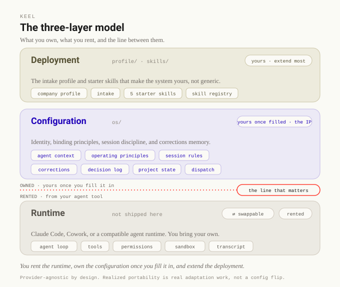

# Keel

*An operating layer for a firm of one.*

A free, open-source operating layer for running a one-person (or few-person) professional
practice the way a larger firm runs itself. A written context. A voice that holds steady across
every piece of writing. A memory of past corrections that doesn't repeat them. A handful of skills
that turn a general-purpose coding agent into an operator who already knows your business.

## What this is

Keel is the machine-enforceable half of a firm's operating judgment: the part that can
be written down, checked, and run consistently by an agentic coding tool (Claude Code, Cowork, or
any compatible agent runtime). Fill in your own identity, voice, and services, and the scaffold
does the rest. It keeps your agent oriented at the start of every session, keeps your voice
consistent across every piece of writing, remembers corrections instead of repeating them, and
closes every session through the same discipline instead of a different one each time.

It ships as a git template repository. Make your own copy, fill in the profile, and you have a
working operating layer for your practice instead of weeks of ad hoc setup. Budget for the
thinking rather than the typing: across twenty-four questions the intake asks you to be specific
about your positioning, your voice, your values, your services, and what genuinely sets you apart.
Filling that in is quick. Knowing your answers is the part that takes real time.

## What this isn't

- **Not the judgment itself.** This scaffold encodes the parts of running a practice that can be
  turned into a checklist, a template, or a rule. Design taste, client relationships, hiring calls,
  and strategic judgment stay with you. See `docs/three-layer-model.md` for where that line sits.
- **Not a hosted product.** There is no server, no login, no subscription attached to this
  repository. Everything runs inside your own agent session, on your own machine, under your own
  account.
- **Not provider-portable out of the box.** The templates are written to be provider-agnostic in
  design: nothing here hardcodes a specific vendor. But they are authored and first tuned against
  Claude-family agent runtimes in practice. Running them against a different provider is a real
  adaptation task, not a flip of a configuration flag.
- **Not all-or-nothing.** Laid out in full it looks like a lot of apparatus for one person, and it
  would be if you had to fill it all in at once. You don't. Start with the profile, one skill, and
  file-based memory (Tier 1 in `docs/memory.md`, nothing to install). The corrections registry
  begins at five framework-level seeds and earns new entries only when something actually goes
  wrong twice. The rest sits there until you want it.

## Who this is for

Solo consultants and small studios (one person, or a handful) doing knowledge work: design,
development, consulting, coaching, or an adjacent service practice, usually without a dedicated
operations or engineering function of their own.

## Quickstart

Two ways in. Have your agent do the setup for you, or place each piece by hand. If you'd rather
see where this ends up before you start, [`examples/`](examples/README.md) has one instance filled
in end to end for a fictional firm.

**Fast path (recommended).** Open `docs/bootstrap-prompt.md` and paste it into your agent inside
your own copy of this repository. It interviews you, fills in the templates, merges the starter
corrections, registers the starter skills, wires everything into your runtime, and proves each
step worked before it stops.

**By hand:**

1. **Get your own copy.** This is a GitHub template repository. Click **Use this template ->
   Create a new repository** to make your own, then clone it:
   `git clone https://github.com/<your-account>/<your-repo>.git`. No GitHub account? Use the green
   **Code -> Download ZIP** button and unpack it.
2. **Read `docs/three-layer-model.md` first.** It explains what this repository owns and what your
   agent runtime provides, which is what makes every step after it make sense.
3. **Fill in `profile/company-profile.template.yaml`** (or work through
   `profile/intake-conversation.md` as a guided self-interview, if you'd rather talk it out than
   fill in YAML directly).
4. **Follow `docs/setup-guide.md`** to place and wire the configuration templates, deploy the
   skills, and run your first session.

## The three-layer model

Full explanation: `docs/three-layer-model.md`. All five figures in one place: `docs/architecture.md`.

## What's inside

- `os/` : the configuration layer. Your agent's context bundle, operating principles, session
  workflow, and corrections memory, all as fillable templates.
- `profile/` : the intake schema that captures your firm's identity, voice, and services.
- `skills/` : seven parameterized starter skills (`voice`, `proposal`, `session-integrity`,
  `project-scanner`, `intelligence-processor`, `session-start` and `session-end`), the registry
  that lets your agent find them, and evaluation cases for each.
- `AGENTS.md` and a thin `CLAUDE.md` : the root instruction file every session loads, readable by
  any runtime that reads `AGENTS.md`. `SETUP.md` covers joining an instance that already runs.
- `docs/` : the setup guide, the three-layer model, the architecture figures, and your memory
  options.
- `examples/` : one worked instance, filled in end to end for a firm that doesn't exist, so you
  can see what a finished profile, agent context, decision log, corrections registry, and set of
  skills actually look like. Copy the templates, not the example.
- `memory/` : an optional, self-contained reference adapter for the Tier-2 memory shape in
  `docs/memory.md` (a single-file SQLite store with FTS5 keyword search by default and an optional,
  injected-embedder semantic leg, behind one stable contract). Opt-in; the scaffold works without it.
- `tests/` : the test suite covering the registry search, the eval-case linter, and the
  confidence gate. Run it with
  `python3 -m pip install -r requirements.txt -r requirements-dev.txt && pytest` (a
  `python3 -m venv .venv && source .venv/bin/activate` first keeps it off your system Python; on
  Windows, `py -m venv .venv` then `.venv\Scripts\activate`).

Python 3.9 or newer runs everything here. The suite is tested through 3.14, and CI covers 3.9,
3.11, and 3.13. Nothing here is installed as a package: you clone this repository and run the
scripts in place, so the interpreter version is the only requirement to satisfy.

## Working with HeyHi

This scaffold is free and stays free. If you want another firm's judgment applied to your specific
practice (calibrating the templates, auditing what's currently ungoverned, or building the pieces
that are genuinely particular to how you work), that's a separate, paid conversation. Let's talk
about what fits: [heyhi.design](https://heyhi.design).

## The corrections cut

If you only want the corrections-memory piece (the pattern that turns a repeated mistake into a
rule your agent won't forget), it ships standalone as
[`agent-corrections`](https://github.com/heyhi-design/agent-corrections).

## License

Code in this repository is licensed under the MIT License. See `LICENSE`. "HeyHi" and its logo are
trademarks of Bay Design LLC and are not covered by the MIT license.
