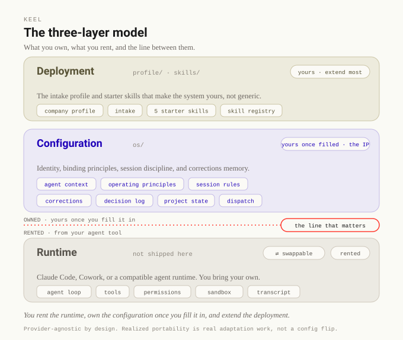
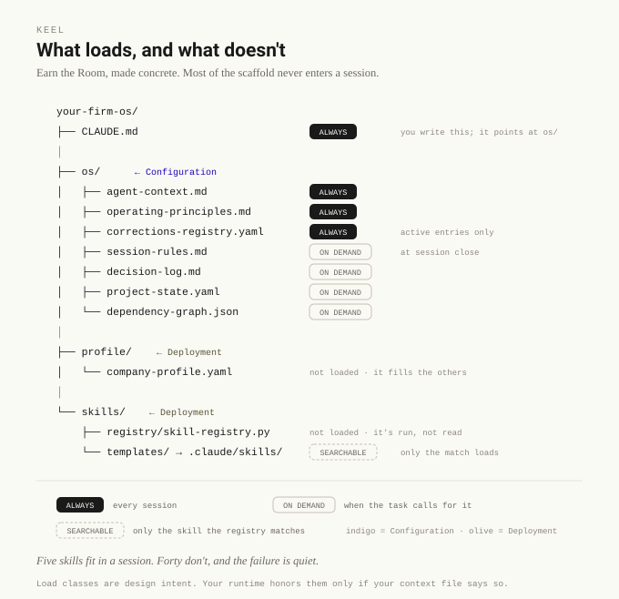
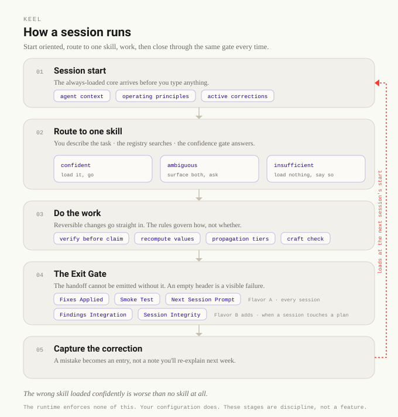
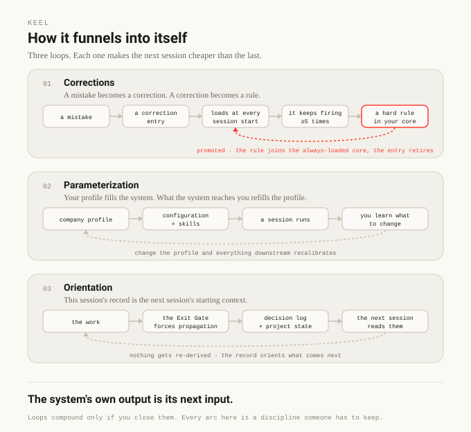
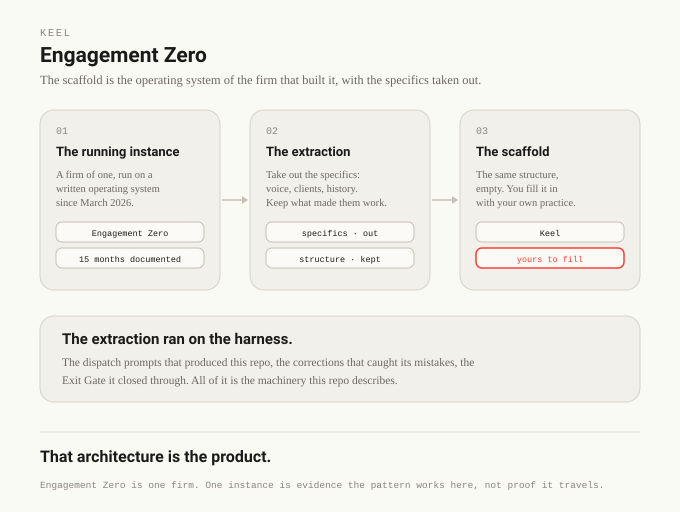

# Architecture

Five figures. Read them in order the first time; after that, each one stands alone.

Every figure carries its own caveat in the footer rather than overclaiming, and each renders in
light and dark.

## 1. The three-layer model

Three layers, three different owners. You rent the runtime from your agent tool. The configuration
is yours once you fill it in, and it is the part that accumulates value. The deployment layer is the
one you will extend the most.

The line between rented and owned is the one worth knowing, because it is the line a change of agent
tool has to respect.

Detail: [`three-layer-model.md`](three-layer-model.md)

## 2. What loads, and what doesn't

Most of the scaffold never enters a session. Three files load every time. Four load only when a task
calls for them. The skills load only when the registry matches one, and your company profile never
loads at all, because its job is to fill the other files rather than to sit in context.

This is what "Earn the Room" means in practice: nothing gets context by default.

Detail: [`setup-guide.md`](setup-guide.md), Step 2 and Step 4

## 3. How a session runs

Start oriented, route to one skill, do the work, close through the same gate every time.

The confidence gate is the part worth studying. A registry that answers "insufficient" honestly is
more useful than one that always returns something, because the wrong skill loaded confidently is
worse than no skill at all.

Detail: [`../skills/registry/README.md`](../skills/registry/README.md)

## 4. How it funnels into itself

Three loops, and together they are the reason session ten is more reliable than session one.

Corrections turn a repeated mistake into a rule that loads before the mistake can happen again.
Parameterization pushes a change in your profile through everything downstream. Orientation makes
this session's record the next session's starting context, so nothing gets re-derived.

The loops only compound if you close them. Every arc in that figure is a discipline someone has to
keep.

Detail: [`../os/corrections/LIFECYCLE.md`](../os/corrections/LIFECYCLE.md)

## 5. Engagement Zero

Where the scaffold came from, and what that does and does not prove.

## Using these figures

Each file is a self-contained SVG with no external dependencies. Colors live in a `<style>` block
with a `prefers-color-scheme` override, so a figure follows your theme where the renderer supports
it and falls back to the light palette where it doesn't. Type falls back cleanly where the fonts
aren't available.

The figures are MIT licensed along with the rest of this repository's documentation. The "HeyHi"
name and logo are trademarks of Bay Design LLC and are not covered by that license.
