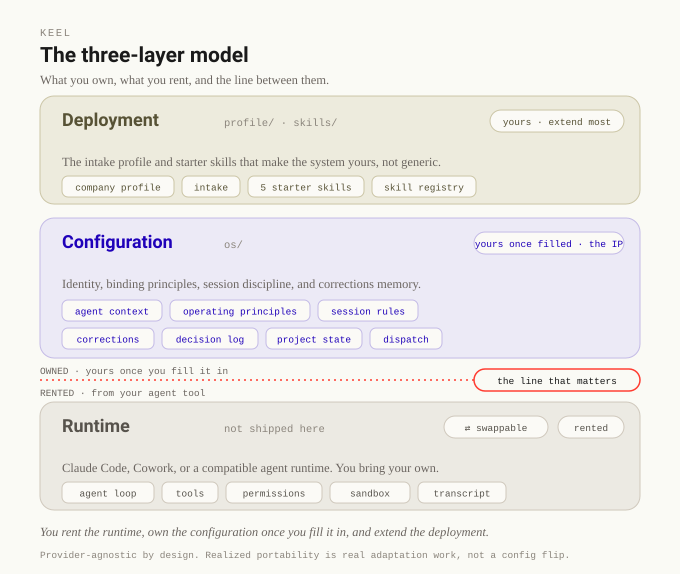

# The Three-Layer Model

Keel is built on a simple separation: three layers, three different owners. Knowing
which layer you're looking at tells you who is responsible for it, whether you can edit it safely,
and what happens to it when you change agent tools.



The rest of this page is that figure in words. Every figure in the set: [`architecture.md`](architecture.md).

## Layer 1: Runtime (your agent tool)

The runtime is the execution substrate: the loop that reasons and acts, the tool-calling
mechanism, the permission system, and the sandboxed environment your agent operates in. This
project does not implement any of it. You bring your own agent tool (Claude Code, Cowork, or any
compatible agent runtime) and this layer is entirely theirs.

**You don't own this layer. You rent it.** If you switch agent tools, this is the layer that
changes; the layers above should not need to.

## Layer 2: Configuration (`os/`)

The configuration is what turns a general-purpose agent into an operator who knows your firm: your
identity and voice, your binding operating principles, your session workflow, and your corrections
memory (the record of mistakes your agent has already made once and should not make again).

This project ships this layer as fillable templates. Once you fill them in, they're yours: the
actual content (your voice, your constraints, your history of corrections) is not something a
template can generate for you.

**You own this layer once you fill it in.** It's the part of the scaffold with the most lasting
value, because it's the part that accumulates: every correction you record makes the next session
a little more reliable.

## Layer 3: Deployment (`profile/` and `skills/`)

The deployment layer is how the configuration becomes a working day-to-day system: the intake
profile that captures your firm's identity and services, the starter skills that give your agent
concrete procedures to run (writing in your voice, drafting a proposal, checking a session's own
work, reporting status, processing new research), and the registry that lets your agent find the
right skill for a given task instead of loading everything all the time.

**You own this layer too**, and it's the layer you'll extend the most: new skills as your practice
grows, new profile fields as you learn what you actually need captured.

## How the layers compose

```
Runtime            Loads your Configuration at the start of every session. Nothing about
(your agent tool)   the runtime knows it's "your firm" until the configuration arrives.

Configuration       Is filled in and parameterized by your Deployment layer: your profile
(os/)               feeds the skills, and the skills know what your firm actually does.

Deployment          Your profile is what you fill in first; your skills come alongside or
(profile/, skills/) after Configuration. Together they make it specific to you, not generic.
```

Change your profile (a new service, a new voice rule) and the skills that depend on it should
recalibrate. Change your agent tool and only Layer 1 changes; Layers 2 and 3 should carry over
unchanged, because nothing in them names a specific vendor.

## A caveat worth taking seriously

The templates in this repository are written to be **provider-agnostic in design**: nothing here
hardcodes a specific agent vendor, and the schema and file structure don't assume one. But they are
**authored and first tuned against Claude-family agent runtimes in practice**. If you run this
scaffold against a different provider, expect to adapt the phrasing and structure of the templates
to that provider's conventions. Provider-agnostic design is an architectural property; it is not
the same claim as "already proven portable," and this project doesn't claim the second one yet.

## Where to go next

- `docs/setup-guide.md` walks through standing up all three layers for the first time.
- `docs/memory.md` covers the options for giving your agent memory that survives across sessions.
- `profile/company-profile.template.yaml` is where Layer 3 starts.
